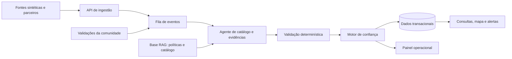

# Plano de aprendizagem — Live Price

## Visão

O Live Price é uma plataforma fictícia de inteligência de preços em tempo real. Ela recebe registros de fontes imperfeitas, normaliza produtos com auxílio de IA, avalia evidências, calcula confiança e apresenta as informações com transparência sobre sua qualidade.

O projeto existe para praticar engenharia de software em condições próximas às de produção, sem a obrigação de captar usuários ou operar um serviço público. Dados, parceiros, incidentes e requisitos serão simulados.

## Objetivos de aprendizagem

- Usar Mastra, agentes, tool calling, RAG e avaliações de IA em um fluxo de negócio concreto. Este é o objetivo principal.
- Operar IA em produção simulada: custo, latência, tracing, revisão humana e segurança contra prompt injection.
- Projetar e operar sistemas distribuídos localmente em Kubernetes. Objetivo secundário, com escopo enxuto.
- Trabalhar com comunicação assíncrona, consistência eventual, idempotência, retries e dead-letter queues.
- Investigar desempenho de banco de dados sob carga por meio de métricas e experimentos.
- Evoluir um monólito modular para serviços separados quando houver pressão medida para isso.
- Praticar disponibilidade, observabilidade, segurança, custo e resposta a incidentes.
- Exercitar as capacidades de um FDE: descoberta, integração, trade-offs, documentação e comunicação de decisões.

## Princípios

1. **Local primeiro.** O sistema roda com Docker Compose no início e passa para `kind` ou `k3d` no ciclo 9. Cloud entra em uma etapa futura, como extensão deliberada do laboratório.
2. **Começar estreito.** A primeira versão trabalha com uma única categoria de supermercado, poucos estabelecimentos e dados sintéticos.
3. **Monólito modular antes de microsserviços.** Serviços são extraídos por uma necessidade demonstrada por métricas, falha ou ritmo de mudança.
4. **IA não é fonte de verdade.** Regras objetivas continuam determinísticas. Agentes lidam com ambiguidade e sempre retornam resultado estruturado, evidências e justificativa.
5. **RAG fornece contexto.** Preços e histórico vêm de ferramentas que consultam dados estruturados; RAG apoia políticas, documentação, sinônimos e conhecimento não estruturado.
6. **Eventos são auditáveis.** Todo evento relevante possui identificador, versão, origem, data e correlação.
7. **Medir antes de otimizar.** Banco alternativo, cache, busca e novos serviços entram após uma hipótese mensurável.

## Contexto de domínio inicial

### Atores

- **Contribuidor:** envia um preço observado.
- **Validador da comunidade:** confirma, contesta ou acrescenta evidência a um preço.
- **Analista operacional:** investiga decisões, evidências e inconsistências.
- **Parceiro:** envia dados em formatos próprios, como API, CSV ou catálogo legado.
- **Agente de catálogo e evidências:** normaliza registros e propõe um nível de confiança.

### Primeiro caso de uso

Um parceiro fictício envia uma entrada imperfeita:

```text
ARZ TJ PARB 5KG | R$ 34,90 | Supermercado Central
```

O sistema deve identificar o produto canônico, validar campos objetivos, buscar evidências, calcular confiança e escolher como o dado será disponibilizado.

```json
{
  "catalogProductId": "rice-tio-joao-parboiled-5kg",
  "confidence": 0.68,
  "status": "published_cautiously",
  "reasons": [
    "Descrição compatível com produto conhecido",
    "Preço abaixo da mediana local",
    "Fonte ainda não possui histórico"
  ],
  "requestedEvidence": ["community_confirmation"]
}
```

### Estados de um preço

```text
received
  → needs_evidence
  → published_cautiously
  → community_confirmed
  → disputed
  → expired
  → retracted
```

Publicar e promover são decisões diferentes. Um preço pode aparecer como informação não confirmada, mas só pode entrar em rankings, alertas ou recomendações após alcançar confiança suficiente.

### Sinais de confiança

- recência do registro;
- reputação contextual da fonte;
- confirmações independentes;
- comprovação anexada;
- compatibilidade com o histórico local;
- divergência de preço em relação à distribuição esperada;
- contestação por produto, embalagem, condição ou validade;
- expiração ao longo do tempo;
- sinais de fraude ou coordenação suspeita.

## Arquitetura de referência



## Stack inicial

| Necessidade | Escolha inicial | Entra no ciclo |
| --- | --- | --- |
| Linguagem e backend | TypeScript com Fastify ou NestJS | 1 |
| IA | Mastra com provider abstraído; Ollama local quando viável | 1 |
| Banco transacional e vetorial inicial | PostgreSQL com `pgvector` | 1 |
| Ambiente local | Docker Compose | 1 |
| Avaliações de IA | Scripts próprios ou ferramenta de evals, com dataset versionado | 2 |
| Observabilidade de IA | OpenTelemetry com traces das chamadas ao LLM | 6 |
| Interface operacional | React, mínima | 6 |
| Cache e jobs simples | Redis | 8 |
| Eventos | NATS JetStream | 8 |
| Kubernetes local | `kind` ou `k3d` com Helm | 9 |
| Arquivos | MinIO | quando houver necessidade |
| Métricas e logs | Prometheus, Grafana, Loki e Tempo | 11 |

Tecnologias como Qdrant, OpenSearch, ClickHouse, Redpanda/Kafka e outros bancos devem ser adotadas somente após um experimento demonstrar uma limitação relevante da solução atual.

## Roadmap por ciclos

Cada ciclo termina com uma demonstração, uma decisão registrada e ao menos um cenário de falha ou dado ruim reproduzível.

O roadmap tem três trilhas. A trilha de IA é o foco do estudo. A trilha FDE entra cedo. A trilha de plataforma é conhecida, então fica enxuta e vem depois.

### Trilha de IA (foco principal)

| Ciclo | Entrega | Foco | Tempo máximo |
| --- | --- | --- | --- |
| 0. Fundação | Visão de produto, linguagem ubíqua, contratos dos primeiros eventos e ADRs | DDD e produto | 1 semana |
| 1. Core com IA | Agente Mastra normaliza preços malformados e retorna decisão estruturada. Roda em processo simples, com Postgres no Docker Compose | Tool calling, saída estruturada e guardrails | 2 semanas |
| 2. Avaliações de IA | Dataset rotulado, métricas, comparação de modelos e versões de prompt, execução automática | Evals e regressão de qualidade | 2 semanas |
| 3. Catálogo e RAG | Catálogo, sinônimos, regras e documentos recuperáveis, medidos pelos evals do ciclo 2 | Embeddings, chunking e recuperação | 2 semanas |

### Trilha FDE (entra cedo)

| Ciclo | Entrega | Foco | Tempo máximo |
| --- | --- | --- | --- |
| 4. Mini-capstone FDE | Parceiro fictício envia CSV sujo. Depois chega uma mudança de requisito. Entrega ponta a ponta com o agente | Descoberta, integração e comunicação de decisões | 1 a 2 semanas |
| 5. Confiança comunitária | Confirmações, contestações, evidências, expiração e score explicável. O agente propõe, a regra decide | Domínio, fraude e explicabilidade | 2 semanas |
| 6. IA em operação | Tracing de cada decisão, custo e latência por chamada, fila de revisão humana, painel operacional mínimo | Observabilidade de IA e humano no ciclo | 2 semanas |
| 7. Segurança de IA | Prompt injection em descrições de produto, vazamento de dados, limites de custo, auditoria das decisões | Segurança e custo de LLM | 1 a 2 semanas |

### Trilha de plataforma (enxuta, depois da IA)

| Ciclo | Entrega | Foco | Tempo máximo |
| --- | --- | --- | --- |
| 8. Ingestão por eventos | Outbox, idempotência, retries, DLQ e rastreamento | Eventos | 1 semana |
| 9. Kubernetes local | Deploy com `kind` ou `k3d` e Helm, sem otimizar | Deploy | 1 semana |
| 10. Tempo real e escala | SSE ou WebSocket, alertas, gerador de massa e planos de consulta | Fan-out e PostgreSQL | 2 semanas |
| 11. Resiliência | Falhas de banco, fila, rede e LLM. Fallback entre modelos, SLOs e postmortems | SRE aplicado à IA | 1 semana |
| 12. Capstone FDE | Cliente fictício, integração legada, incidente e mudança de requisito | Entrega ponta a ponta | 2 semanas |

Se um ciclo passar do tempo máximo, pare. Registre o que aprendeu em um ADR e siga para o próximo.

## Avaliação de IA

O agente será avaliado com uma coleção crescente de casos sintéticos rotulados, não apenas por uma demonstração manual.

Casos iniciais:

- descrição ambígua;
- produto correto com peso ou unidade incorretos;
- valor com separador decimal inválido;
- promoção que exige condição não informada;
- produto inexistente no catálogo;
- preço muito baixo, mas válido;
- preço suspeito de fonte nova;
- fontes independentes que discordam.

Métricas propostas:

- precisão na normalização do produto;
- acerto de peso, unidade e embalagem;
- qualidade do encaminhamento para evidência;
- taxa de informações inventadas;
- latência e custo por decisão;
- presença e qualidade das evidências citadas;
- resultados por modelo e versão de prompt.

## Cadência de estudo

Para cada incremento:

1. Descrever o problema e a hipótese.
2. Implementar a menor solução que permita observar o comportamento.
3. Gerar dados, carga ou falhas relevantes.
4. Medir latência, custo, erros e qualidade.
5. Registrar a decisão em um ADR curto.
6. Simular uma nova exigência de stakeholder, incidente ou integração defeituosa.

## Critério de conclusão por ciclo

- Fluxo demonstrável em ambiente local.
- Dados e cenário de teste reproduzíveis.
- Telemetria suficiente para explicar o resultado.
- Trade-offs registrados em documentação.
- Uma decisão explícita sobre o próximo problema a resolver.

## Próximo passo

Iniciar o Ciclo 0 com quatro artefatos:

1. visão de produto de uma página;
2. linguagem ubíqua e modelo de domínio inicial;
3. contratos dos primeiros eventos;
4. ADR sobre monólito modular, Docker Compose primeiro e provider de LLM.

Depois, vá direto ao Ciclo 1. Kubernetes só entra no Ciclo 9.
